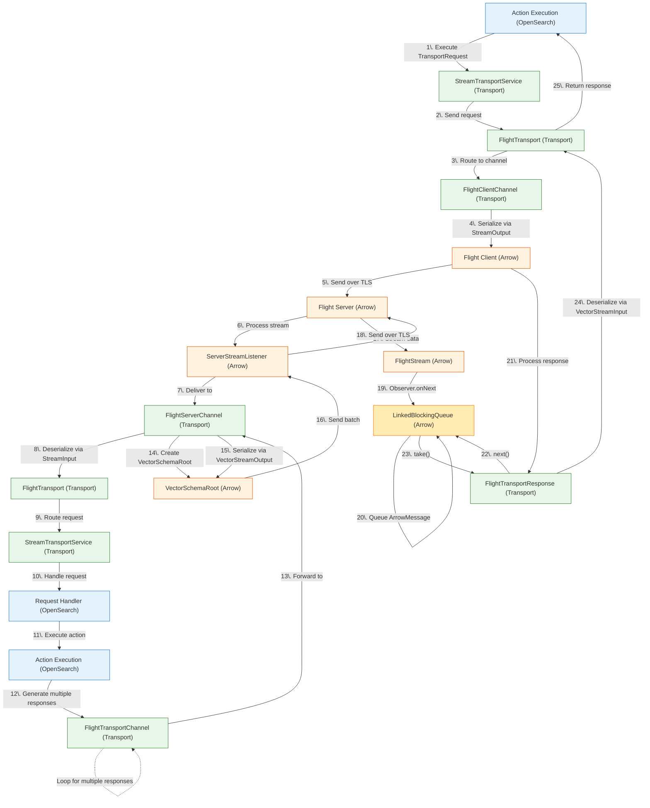

# Arrow Flight RPC Node-to-Node Architecture

## Connections per node

The stream transport opens `transport.stream.connections_per_node` connections to each node it streams with
(default `1`, node-scope, `1` to `16`). This includes nodes of remote clusters reached through the stream
transport.
- **Each connection is independent.** It is its own `FlightClientChannel` wrapping its own `FlightClient`, so it
  has its own gRPC channel, TCP connection, and TCP and HTTP/2 flow-control windows.
- **Requests take turns.** Each `STREAM` request to a node takes that node's next connection, round-robin, per
  node.
- **Connections open lazily.** A gRPC channel opens its TCP connection on first use.
- **Close is all-or-nothing.** If any one connection's channel closes, the whole node connection closes and is
  re-established. Closing it cancels the streams on all its connections before waiting for them to drain.

**Why more than one.** All streams on one connection share its windows, and a connection carries at most about
one window of data per round trip. On high-latency links (cross-region) that caps throughput between two nodes
at roughly `window / RTT`, however many streams there are. With more connections, several busy streams to the
same node each get their own windows. A single stream always stays on one connection, so it does not get faster.

**Cost.** Per node pair, each extra connection adds:
- a socket on both sides (a node receives `(peers) × N` inbound connections);
- up to one HTTP/2 window of unread data on the receiver (auto-tuned up to 8 MiB by gRPC).

The `client_channels_active` metric counts channels, `N` per peer node.
